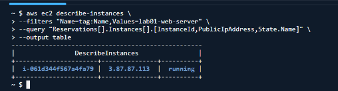
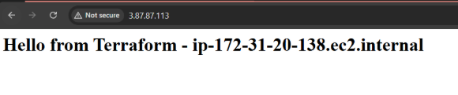

### Question 1: Why is pinning the provider version important for a team project?
- เราจะได้กำหนดให้ทีมใช้ Version ที่เหมือนกันได้และไม่เกิดปัญหาเรื่อง Version ไม่ตรงบ้าง Service ต่างกันบ้างเผื่อมีบางอันที่พอ Version ต่างแล้วทำด้วยกันไม่ได้ถ้าทำไปเยอะแล้วต้องมาย้อน Version ทีหลังก็อาจจะพังได้

#### Checkpoint 2: Record the AMI ID and the default VPC ID in your lab report.
- ```data.aws_ami.amazon_linux.id```: 
"ami-0b2c9d1f3edcfd709"

- ```data.aws_ami.amazon_linux.name```: 
"al2023-ami-2023.12.20260918.0-kernel-6.1-x86_64"

- ```data.aws_vpc.default.id```: 
"vpc-021d46d87fa846497"

### Question 2: How many resources will be added?
- 2 resources:
    - aws_security_group
    - aws_instance

### Question 3: Which attributes show as (known after apply), and why can Terraform not know them yet?
-  เพราะว่าในตอนที่เรา Plan ตัวของ Terraform มันยังไม่รู้ค่าเพราะบางค่าตัวของ AWS จะกำหนดเองตอนที่ Apply

#### Checkpoint 3: Take a screenshot of the working web page and include it in yourReport.




### Question 4: Does Terraform plan to update in place or to replace the instance? 
> Lookfor the ~ or -/+ symbol and explain what it means.
- มันจะแสดงค่าที่ถูกเปลี่ยนใหม่เช่นเราเปลี่ยนจาก micro เป็น small และ dns กับ IP ที่เปลี่ยนเพราะมีการเปลี่ยน Instance ใหม่

### Question 5: How did the plan output change compared to Step 4.1? Why would this matter for a production web server?

- ในส่วนของ Output ที่ Plan ไม่มีอะไรต่าง แต่การทำงานพอเราเพิ่ม create_before_destroy = true สิ่งที่มันจะทำต่างจากเดิมคือ จะทำการสร้าง Instance ขึ้นมาก่อนที่จะลบ Instance อันเก่าทิ้งเพื่อช่วยลด Downtime และใช้งานได้ต่อเนื่อง

### Question 6: What error do you get, and at what stage does it occur — apply or destroyed ?

- Error: Instance cannot be destroyed เพราะว่าใน Lifecycle เราได้ใส่ prevent destroyed เอาไว้ทำให้พอเรา destroyed มันเลย error