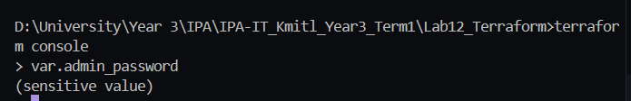
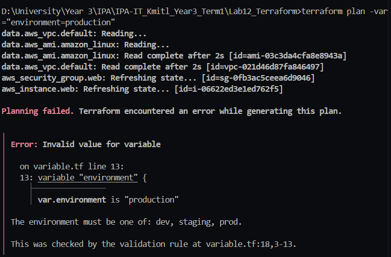
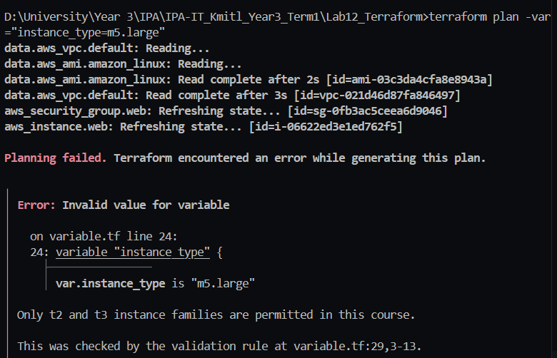
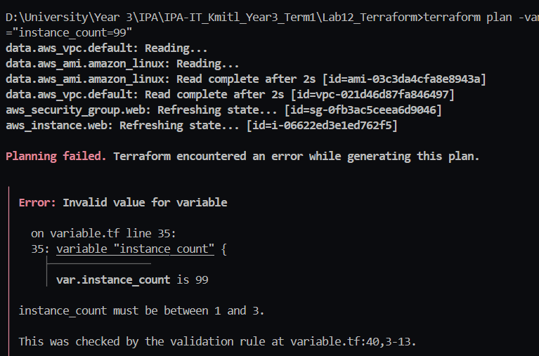
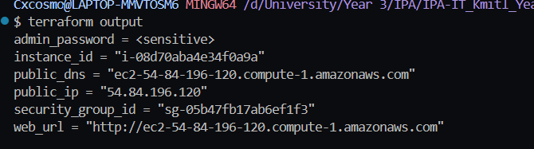
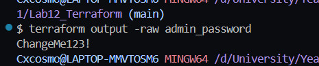
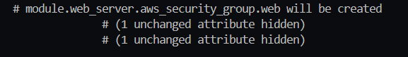
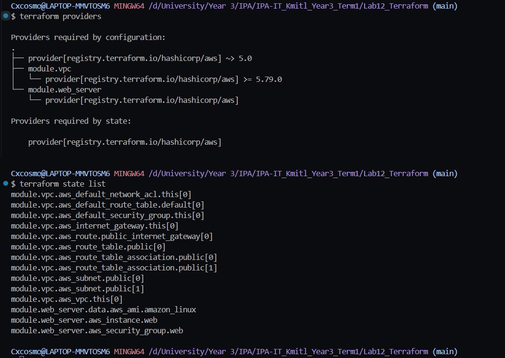

### Question 1: After you apply, what does Terraform print where a sensitive value would appear? Is the value still stored in the state file? (Answer from the book, Chapter 3.3.)
- จะเห็นค่าเป็น Sensitive Value 

- ส้วนึ State File ก็ยังเก็บค่าเป็นข้อความธรรมดา
 

#### Checkpoint 1: Capture the three error messages. Note at what stage validation fails — does Terraform contact AWS first?




### Question 2: What is the difference between a local and a variable with a default? Give one situation where only a local will work.
- Local จะเป็นค่าที่คำนวณภายใน Config เองผู้ใช้ภายนอกส่งค่าเข้ามาไม่ได้
- Variable เป็นค่า input ที่ผู้เรียกใช้ส่งเข้ามาได้
> ยกตัวอย่าง ชื่อ prefix ที่ประกอบจาก variable สองตัว 

```name_prefix = "${var.project_name}-${var.environment}"```
ถ้าเขียนเป็น default มันจะ error เพราะ default อ้างถึง variable อื่นไม่ได้

#### Checkpoint 2: What is printed for admin_password by terraform output? Now run terraform output -raw admin_password. What happens, and what does that tell you about how sensitive protects you?


- sensitive ช่วยแค่กันไม่ให้ค่าหลุดออกมาบนหน้าจอหรือใน log แต่ไม่ได้ป้องกันคนที่เข้าถึง state ได้

#### Checkpoint 3: In the plan output, what is the full resource address of the instance now? (Hint: it starts with module.) Compare it to the address in Lab 1.


### Question 3: Terraform will likely plan to destroy and recreate your resources even though the configuration is functionally identical. Why?
- เพราะ resource address เปลี่ยน จาก aws_instance.web เป็น module.web_server.aws_instance.web
Terraform ผูก resource ใน state ไว้กับ address ไม่ได้ดูว่าโค้ดข้างในเหมือนเดิมหรือเปล่า พอ address เดิมหายไป Terraform จะเข้าใจว่าต้องลบ resource นั้นทิ้งและเมื่อมี address ใหม่ที่ยังไม่มีใน state ก็จะเข้าใจว่าต้องสร้างใหม่

### Question 4: Why is version = "~> 5.0" required for a registry module but not for a local ./modules/... module?
ถ้าไม่ระบุ version อาจได้เวอร์ชันล่าสุดที่มี error ทำให้ config ที่เคยใช้ได้พัง และ argument version ใช้ได้เฉพาะ module จาก registry

#### Checkpoint 4: Run terraform providers and terraform state list. How many resources did the VPC module create on your behalf?



### What did moving code into a module make easier, and what did it make harder?

- ทำให้ reuse ได้ง่ายขึ้น เพราะสร้าง web server หลายชุดหรือหลาย environment ได้ ด้วยการเรียก module ซ้ำแล้วส่ง input ต่างกัน โดยไม่ต้อง copy โค้ดทั้งก้อน